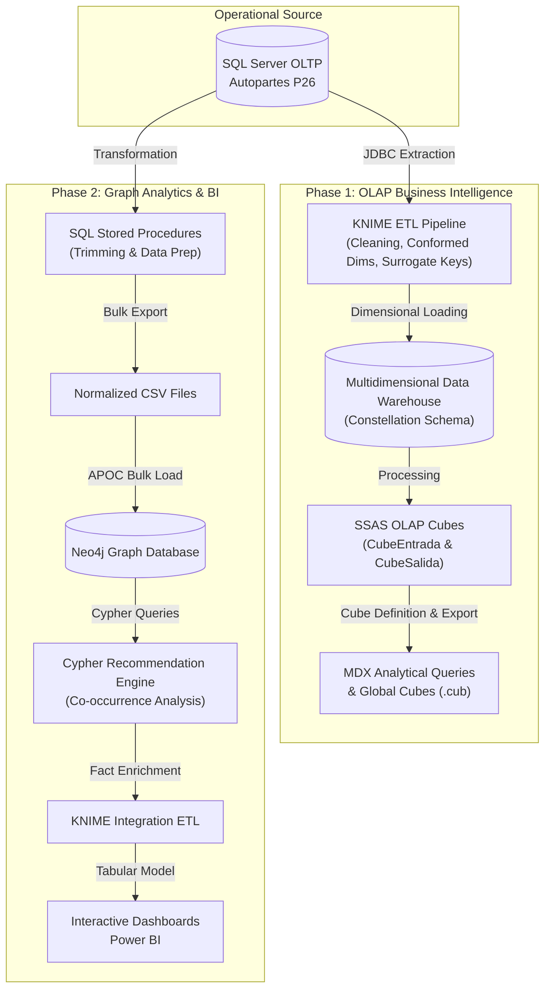

# Data Warehouse & Graph Analytics: Autopartes P26

[](https://www.microsoft.com/sql-server)
[](https://learn.microsoft.com/analysis-services/)
[](https://neo4j.com/)
[](https://www.knime.com/)
[](https://powerbi.microsoft.com/)

End-to-end data engineering and analytics project developed for the **Data Warehousing** coursework (Computer Systems Engineering degree).

The project designs, implements, and evaluates an enterprise **Data Warehouse** coupled with a **Graph-based Recommendation Engine** for warehouse inventory movements, purchasing operations (inputs / entradas), and sales operations (outputs / salidas) for the auto parts distributor **Autopartes P26**.

---

## 1. General System Architecture

The project spans the full data lifecycle: from the relational transactional system to multidimensional OLAP cubes, graph-based co-occurrence analytics, and interactive executive dashboards.



---

## 2. Repository Layout

```plaintext
ProjectDataWarehouse/
├── fase_1_olap/                               # PHASE 1: Data Warehouse & Multidimensional Cubes
│   ├── README.md                              # Detailed Phase 1 documentation
│   ├── database/                              # Original relational database
│   │   ├── BaseDeDatos.sql                    # Operational table schema definitions
│   │   └── Poblador.sql                       # Historical operational data seed
│   ├── etl/                                   # KNIME ETL workflows
│   │   └── Primera_entrega.knwf               # Extraction and dimension loading workflow
│   ├── mdx/                                   # MDX scripts and global cubes
│   │   ├── CreateCubeSalida.MDX               # MDX script for outputs global cube
│   │   ├── MDXEntrada.mdx                     # MDX script for inputs global cube
│   │   ├── CUBEENTRADA.cub                    # Compiled offline cube (inputs)
│   │   └── CUBESALIDA.cub                     # Compiled offline cube (outputs)
│   └── ssas/                                  # SQL Server Analysis Services project
│       ├── Entrega1.sln                       # Visual Studio solution
│       ├── Entrega1.dwproj                    # SSAS project file
│       ├── CubeEntrada.cube                   # Inputs OLAP cube
│       ├── CubeSalida.cube                    # Outputs OLAP cube
│       ├── Dim Articulo.dim                   # Article dimension
│       ├── Dim Cliente.dim                    # Customer dimension
│       ├── Dim Entrada.dim                    # Input header dimension
│       ├── Dim Salida.dim                     # Output header dimension
│       ├── Dim Time.dim                       # Time dimension
│       ├── Dim Vendedor.dim                   # Salesperson dimension
│       ├── DS.ds                              # Data source configuration
│       └── DSV.dsv / DSVP26.dsv               # Data source views
│
├── fase_2_grafos_bi/                          # PHASE 2: Graph DB, Recommender & Dashboards
│   ├── README.md                              # Detailed Phase 2 documentation
│   ├── data_csv/                              # Exported CSVs for Neo4j ingestion
│   │   ├── Articulo.csv, Cliente.csv, ...     # 13 CSV files (catalogs and transactions)
│   ├── sql/                                   # Stored procedures for graph data preparation
│   │   └── Relacional_A_Grafos.sql            # Procedures with TRIM and formatting logic
│   ├── neo4j/                                 # Graph queries and database backups
│   │   ├── Importacion_en_Neo4j.cql           # Cypher script (schema, APOC ingestion)
│   │   └── proyectofase2-2026-05-13T20-36-06.dump # Full binary database dump
│   ├── etl/                                   # KNIME Phase 2 pipeline
│   │   └── Proyecto_Fase_2.knwf               # Recommendation ingestion into DWH
│   └── power_bi/                              # Business Intelligence dashboards
│       ├── ProyectoF2_Entradas.pbix           # Restocking & inputs dashboard
│       └── Tableros_Proyecto_Fase_2_Salidas.pbix # Sales & recommendations dashboard
│
├── .gitignore                                 # Git exclusions (build caches, binaries, docs)
└── README.md                                  # Root technical documentation
```

---

## 3. Phase Summaries

### [Phase 1: Data Warehouse & OLAP Cubes](file:///c:/Users/diego/Documents/GitHub/Sexto%20Semestre/ProjectDataWarehouse/fase_1_olap/README.md)
* **Dimensional Modeling:** **Fact Constellation Schema** with two central fact tables (`FactEntrada` and `FactSalida`) linked to conformed dimensions (`DimArticulo`, `DimTime`, `DimMoneda`).
* **KNIME ETL:** Extraction from SQL Server, whitespace trimming, surrogate key assignment, null handling, and date conversions.
* **SSAS Cubes:** Volume metrics (`Cantidad`), financial indicators (`Precio`, `Total Importe`, `Total Descuento`, `Total Impuesto`), and distinct operation counts (`Folio`).
* **MDX:** Portable offline `.cub` global cube generation for decoupled reporting.

### [Phase 2: Graph Analytics & Recommendation Engine](file:///c:/Users/diego/Documents/GitHub/Sexto%20Semestre/ProjectDataWarehouse/fase_2_grafos_bi/README.md)
* **Neo4j Graph Model:** Nodes for items, orders, customers, and agents, interconnected via transactional co-occurrence relationships (`TIENE_DETALLE`, `APARECE_EN_DETALLE`).
* **APOC Bulk Ingestion:** Parallel batch execution (10,000 records per transaction) for high-performance loading.
* **Recommendation Algorithm:** Association rules based on historical co-occurrence frequency within the same transaction folio.
* **Warehouse Integration:** Enriches the warehouse with `FactRecomendacionSalida` and `FactRecomendacionEntrada`.
* **Power BI Dashboards:** Interactive filtering by article description (validated against 15 test cases) with complementary cross-selling metrics.

---

## 4. Key Business Insights
1. **Top Revenue Groups:** **Chevrolet** led all brands in total monetary sales during 2022, followed by **Ford**.
2. **Sales Volume vs. Revenue Divergence:** **Nissan** generated the highest unit sales volume, yet yielded lower total revenue than Chevrolet due to a lower average price point.
3. **Highest-Turnover Refurbishment Parts:**
   - *Side clearance lamps (Cuartos):* 463,104 units sold.
   - *Side mirrors (Espejos Laterales):* 343,486 units sold.
   - *Headlights (Faros):* 325,843 units sold.
4. **Internal Audit Anomaly Detection:** A large cluster of sales was attributed to unassociated customer IDs (`N/A`), highlighting an essential area for retail compliance and point-of-sale audits.

---

## 5. Deployment and Setup Guide

### Prerequisites
* **Microsoft SQL Server 2019+** and **SQL Server Management Studio (SSMS)**.
* **SQL Server Analysis Services (SSAS - Multidimensional Mode)**.
* **Visual Studio 2022** with the *Microsoft Analysis Services Projects* extension.
* **KNIME Analytics Platform 4.x / 5.x**.
* **Neo4j Desktop 5.x** with the **APOC Core** plugin enabled.
* **Microsoft Power BI Desktop**.

### Step-by-Step Instructions
1. **Database Initialization:**
   ```sql
   -- Run in SSMS:
   -- 1. fase_1_olap/database/BaseDeDatos.sql
   -- 2. fase_1_olap/database/Poblador.sql
   ```
2. **Execute Phase 1 ETL:**
   - Open `fase_1_olap/etl/Primera_entrega.knwf` in KNIME and execute all nodes.
3. **Deploy SSAS Cubes:**
   - Open `fase_1_olap/ssas/Entrega1.sln` in Visual Studio, verify connection in `DS.ds`, then select **Build > Deploy**.
4. **Load Graph in Neo4j:**
   - Restore `fase_2_grafos_bi/neo4j/proyectofase2-2026-05-13T20-36-06.dump` in Neo4j Desktop or CLI, or execute `fase_2_grafos_bi/neo4j/Importacion_en_Neo4j.cql` with files from `data_csv/`.
5. **Run Phase 2 ETL:**
   - Open and execute `fase_2_grafos_bi/etl/Proyecto_Fase_2.knwf` to compute and ingest recommendations into the Data Warehouse.
6. **Open Power BI Dashboards:**
   - Launch `fase_2_grafos_bi/power_bi/Tableros_Proyecto_Fase_2_Salidas.pbix` and `ProyectoF2_Entradas.pbix` in Power BI Desktop.

---

## 6. Academic Credits and Authors
* **Course:** Almacenes de Datos (Data Warehousing - P2026_ESI3887G)
* **Professor:** Dr. Víctor Hugo Ortega Guzmán
* **Degree:** Computer Systems Engineering
* **Authors:**
  - Diego Alonso Gómez Yáñez (ID: 753368)
  - Héctor Alfonso Sandoval Bautista (ID: 737119)
  - Néstor Eduardo Pérez Ávalos (ID: 753844)
