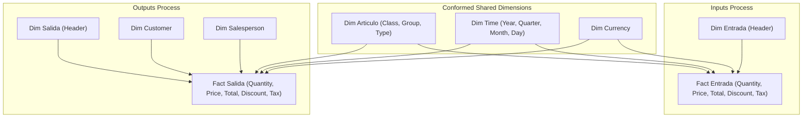

# Phase 1: Multidimensional Data Warehouse and OLAP Cubes (Autopartes P26)

## 1. Project Overview
In this initial phase, a **Data Warehouse** was designed and implemented for the auto parts distribution company **"Autopartes P26"**, focused on strategic analysis of warehouse inventory movements (goods receipt/inputs and goods issue/outputs).

The main objective was to transform transactional operational data into an analytical multidimensional architecture, enabling key performance indicator (KPI) tracking, historical trend analysis, and multidimensional slice-and-dice queries via OLAP cubes in **SQL Server Analysis Services (SSAS)** and **MDX** queries.

---

## 2. Data Architecture and Dimensional Modeling

### 2.1. Operational Relational Database (OLTP)
The operational database captures daily warehouse operations and is created using the following scripts:
* [`BaseDeDatos.sql`](file:///c:/Users/diego/Documents/GitHub/Sexto%20Semestre/ProjectDataWarehouse/fase_1_olap/database/BaseDeDatos.sql): DDL definitions for master catalog tables and transactional tables.
* [`Poblador.sql`](file:///c:/Users/diego/Documents/GitHub/Sexto%20Semestre/ProjectDataWarehouse/fase_1_olap/database/Poblador.sql): Populates historical transactional records.

Operational table categorization:
* **Transactional:** `EntradaEncabezado`, `EntradaDetalle`, `SalidaEncabezado`, `SalidaDetalle`.
* **Catalogs & Master Data:** `Articulo`, `ArticuloTipo`, `ArticuloGrupo`, `ArticuloClase`, `Cliente`, `ClienteTipo`, `Vendedor`, `Moneda`, `CondicionPago`, `MedioEmbarque`.

### 2.2. Dimensional Model (Constellation Schema)
Because the core business handles two distinct operational processes that share several key dimensions, a **Fact Constellation Schema** was implemented:
1. **Fact Entrada:** Warehouse goods receipts and purchasing transactions.
2. **Fact Salida:** Warehouse dispatches and customer sales transactions.

---

## 3. ETL Pipeline with KNIME
The Extract, Transform, and Load (ETL) pipeline was developed using **KNIME Analytics Platform** in the workflow [`Primera_entrega.knwf`](file:///c:/Users/diego/Documents/GitHub/Sexto%20Semestre/ProjectDataWarehouse/fase_1_olap/etl/Primera_entrega.knwf):
1. **Extraction:** JDBC connection to SQL Server to read transaction headers, line items, and dimension catalogs.
2. **Transformation:**
   - Data cleaning and string whitespace trimming (`TRIM`).
   - Date format standardization and surrogate key derivation for the time dimension.
   - Null value handling and assignment of default surrogate records (`N/A`).
   - Hierarchy enrichment for article groupings (Class, Group, Type).
3. **Loading:** Loading transformed staging data into final fact tables (`FactEntrada`, `FactSalida`) and conformed dimension tables.

---

## 4. OLAP Implementation (SSAS)
The **SQL Server Analysis Services** multidimensional solution is located in [`ssas/`](file:///c:/Users/diego/Documents/GitHub/Sexto%20Semestre/ProjectDataWarehouse/fase_1_olap/ssas/):
* **Solution and Project:** [`Entrega1.sln`](file:///c:/Users/diego/Documents/GitHub/Sexto%20Semestre/ProjectDataWarehouse/fase_1_olap/ssas/Entrega1.sln) and `Entrega1.dwproj`.
* **Data Sources & Views:** [`DS.ds`](file:///c:/Users/diego/Documents/GitHub/Sexto%20Semestre/ProjectDataWarehouse/fase_1_olap/ssas/DS.ds), [`DSV.dsv`](file:///c:/Users/diego/Documents/GitHub/Sexto%20Semestre/ProjectDataWarehouse/fase_1_olap/ssas/DSV.dsv), and [`DSVP26.dsv`](file:///c:/Users/diego/Documents/GitHub/Sexto%20Semestre/ProjectDataWarehouse/fase_1_olap/ssas/DSVP26.dsv).
* **Configured Dimensions:**
  - `Dim Articulo.dim`: Hierarchies across Article Group, Class, and Type.
  - `Dim Cliente.dim`: Customer segmentation by customer type and geographic attributes.
  - `Dim Vendedor.dim`: Sales agent performance dimensions.
  - `Dim Time.dim`: Temporal hierarchy (Year, Quarter, Month, Day).
  - `Dim Entrada.dim` and `Dim Salida.dim`: Transactional invoice/folio attributes.
* **Analytical Cubes:**
  - [`CubeEntrada.cube`](file:///c:/Users/diego/Documents/GitHub/Sexto%20Semestre/ProjectDataWarehouse/fase_1_olap/ssas/CubeEntrada.cube)
  - [`CubeSalida.cube`](file:///c:/Users/diego/Documents/GitHub/Sexto%20Semestre/ProjectDataWarehouse/fase_1_olap/ssas/CubeSalida.cube)

### Implemented Measures and Metrics
* `Cantidad`: Physical item units moved.
* `Precio`: Weighted unit price.
* `Total Importe`: Net revenue / order value.
* `Total Descuento`: Granted discounts.
* `Total I Impuesto`: Value-added tax (IVA) amounts.
* `Total`: Gross transaction total.
* `Contar Folio` / `Fact Count`: Distinct transaction count.

---

## 5. MDX Scripts and Offline Global Cubes
Scripts to build portable, disconnected global cubes (`.cub`) were created to enable lightweight offline analysis in Excel or reporting tools:
* [`CreateCubeSalida.MDX`](file:///c:/Users/diego/Documents/GitHub/Sexto%20Semestre/ProjectDataWarehouse/fase_1_olap/mdx/CreateCubeSalida.MDX): Creates global cube `MyCube` from `[CubeSalida]`.
* [`MDXEntrada.mdx`](file:///c:/Users/diego/Documents/GitHub/Sexto%20Semestre/ProjectDataWarehouse/fase_1_olap/mdx/MDXEntrada.mdx): Creates global cube `MyCubeE` from `[CubeEntrada]`.
* Generated binary cube files: `CUBEENTRADA.cub` and `CUBESALIDA.cub`.

---

## 6. Key Business Insights
Multidimensional exploration of the warehouse data during the analyzed period (fiscal year 2022) revealed several critical findings:
1. **Top Revenue Group:** **Chevrolet** generated the highest total sales revenue, followed by **Ford**.
2. **Unit Volume vs. Revenue Discrepancy:** **Nissan** recorded the highest physical unit sales volume in 2022, even though **Chevrolet** yielded higher total monetary revenue due to a higher average item price point.
3. **High-Demand Auto Part Categories:**
   - *Side clearance lamps (Cuartos):* 463,104 units sold.
   - *Side mirrors (Espejos Laterales):* 343,486 units sold.
   - *Headlights (Faros):* 325,843 units sold.
4. **Internal Audit Anomaly Detection:** A significant volume of sales was registered under unidentified or unassociated customers (`N/A`), indicating a crucial compliance point for audit and retail point-of-sale controls.

---

## 7. Execution and Deployment Guide
1. **Database Setup:**
   - Open **SQL Server Management Studio (SSMS)**.
   - Execute `database/BaseDeDatos.sql` to initialize tables and relationships.
   - Execute `database/Poblador.sql` to populate sample operational data.
2. **ETL Execution in KNIME:**
   - Import `etl/Primera_entrega.knwf` into **KNIME**.
   - Configure JDBC connection node credentials and execute all pipeline nodes.
3. **SSAS Cube Deployment:**
   - Open `ssas/Entrega1.sln` with **Visual Studio** (with the *SQL Server Analysis Services Projects* extension installed).
   - Configure connection string in `DS.ds`.
   - Build and Deploy the solution to your SSAS Multidimensional instance.
4. **MDX Cube Creation:**
   - Execute `mdx/CreateCubeSalida.MDX` or `mdx/MDXEntrada.mdx` in SSMS connected to SSAS to generate portable `.cub` files.
