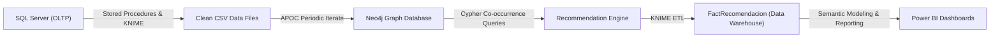

# Phase 2: Graph Database (Neo4j), Recommendation Engine, and Power BI Dashboards

## 1. Project Overview
In the second phase, the **Data Warehouse** was enhanced by integrating **graph database analytics** and an **item recommendation engine** to optimize procurement (goods receipt/inputs) and cross-selling (goods issue/outputs) for the auto parts business.

While traditional OLAP models excel at aggregate summaries and hierarchical rollups, **graph databases** unlock pattern matching and association rule discovery (*Market Basket Analysis*), identifying co-occurring products that are frequently ordered or dispatched together.

---

## 2. Architecture and Pipeline



---

## 3. Relational to Graph Transformation

### 3.1. Clean Extraction Stored Procedures
To ensure that exported data remained free of trailing whitespace and formatting inconsistencies, dedicated stored procedures were implemented in [`Relacional_A_Grafos.sql`](file:///c:/Users/diego/Documents/GitHub/Sexto%20Semestre/ProjectDataWarehouse/fase_2_grafos_bi/sql/Relacional_A_Grafos.sql):
* `SP_Articulo_ST`
* `SP_ArticuloClase_ST`, `SP_ArticuloGrupo_ST`, `SP_ArticuloTipo_ST`
* `SP_Cliente_ST`, `SP_Vendedor_ST`, `SP_Moneda_ST`
* `SP_CondicionPago_ST`, `SP_MedioEmbarque_ST`
* `SP_EntradaEncabezado_ST`, `SP_EntradaDetalle_ST`
* `SP_SalidaEncabezado_ST`, `SP_SalidaDetalle_ST`

### 3.2. Structured CSV Catalog
Processed data was exported into 13 structured files in [`data_csv/`](file:///c:/Users/diego/Documents/GitHub/Sexto%20Semestre/ProjectDataWarehouse/fase_2_grafos_bi/data_csv/):
* `Articulo.csv`, `ArticuloClase.csv`, `ArticuloGrupo.csv`, `ArticuloTipo.csv`
* `Cliente.csv`, `Vendedor.csv`, `Moneda.csv`, `CondicionPago.csv`, `MedioEmbarque.csv`
* `EntradaEncabezado.csv`, `EntradaDetalle.csv`
* `SalidaEncabezado.csv`, `SalidaDetalle.csv`

---

## 4. Neo4j Graph Database Modeling

### 4.1. Nodes and Relationships
The import script [`Importacion_en_Neo4j.cql`](file:///c:/Users/diego/Documents/GitHub/Sexto%20Semestre/ProjectDataWarehouse/fase_2_grafos_bi/neo4j/Importacion_en_Neo4j.cql) defines the graph schema:

* **Node Labels:**
  - `:Articulo`, `:ArticuloClase`, `:ArticuloGrupo`, `:ArticuloTipo`
  - `:Cliente`, `:Vendedor`, `:Moneda`, `:CondicionPago`, `:MedioEmbarque`
  - `:EntradaEncabezado`, `:EntradaDetalle`, `:SalidaEncabezado`, `:SalidaDetalle`

* **Relationship Types:**
  - `(:ArticuloGrupo)-[:AGRUPA_ARTICULO]->(:Articulo)`
  - `(:ArticuloClase)-[:CLASIFICA_ARTICULO]->(:Articulo)`
  - `(:ArticuloTipo)-[:TIPIFICA_ARTICULO]->(:Articulo)`
  - `(:EntradaEncabezado)-[:TIENE_DETALLE_ENTRADA]->(:EntradaDetalle)`
  - `(:Articulo)-[:APARECE_EN_ENTRADA_DETALLE]->(:EntradaDetalle)`
  - `(:SalidaEncabezado)-[:TIENE_DETALLE_SALIDA]->(:SalidaDetalle)`
  - `(:Articulo)-[:APARECE_EN_SALIDA_DETALLE]->(:SalidaDetalle)`
  - `(:Cliente)-[:REALIZA_SALIDA]->(:SalidaEncabezado)`
  - `(:Vendedor)-[:ATIENDE_SALIDA]->(:SalidaEncabezado)`
  - `(:CondicionPago)-[:SE_APLICA_EN_SALIDA]->(:SalidaEncabezado)`
  - `(:MedioEmbarque)-[:SE_USA_EN_SALIDA]->(:SalidaEncabezado)`

### 4.2. High-Performance Batch Ingestion (APOC)
To handle hundreds of thousands of transactional line items efficiently, parallel batch loading was executed with `apoc.periodic.iterate`:
```cypher
CALL apoc.periodic.iterate(
  'LOAD CSV WITH HEADERS FROM "file:///SalidaDetalle.csv" AS row RETURN row',
  'CREATE (n:SalidaDetalle) SET n = row',
  { batchSize: 10000, parallel: true }
);
```

### 4.3. Database Dump Backup (.dump)
A full binary dump of the populated graph database is available in [`neo4j/`](file:///c:/Users/diego/Documents/GitHub/Sexto%20Semestre/ProjectDataWarehouse/fase_2_grafos_bi/neo4j/):
* `proyectofase2-2026-05-13T20-36-06.dump`

---

## 5. Recommendation Engine Algorithm

The engine leverages **transactional co-occurrence**: when item $A$ and item $B$ repeatedly appear together within the same order/dispatch folio, querying for item $A$ produces a ranked recommendation for item $B$, weighted by historical co-occurrence frequency.

### 5.1. Sales Recommendation Query (Cross-selling for Salidas)
```cypher
MATCH (a:Articulo)-[:APARECE_EN_SALIDA_DETALLE]->(:SalidaDetalle)
      <-[:TIENE_DETALLE_SALIDA]-(s:SalidaEncabezado)-[:TIENE_DETALLE_SALIDA]->
      (:SalidaDetalle)<-[:APARECE_EN_SALIDA_DETALLE]-(r:Articulo)
WHERE a.clave < r.clave
RETURN
    a.clave AS FK_ArticuloId,
    r.clave AS FK_ArticuloIdRecomendado,
    count(DISTINCT s.Folio) AS ConteoSalidas
ORDER BY FK_ArticuloId, ConteoSalidas DESC;
```

### 5.2. Supply Procurement Recommendation Query (Bundling for Entradas)
```cypher
MATCH (a:Articulo)-[:APARECE_EN_ENTRADA_DETALLE]->(:EntradaDetalle)
      <-[:TIENE_DETALLE_ENTRADA]-(e:EntradaEncabezado)-[:TIENE_DETALLE_ENTRADA]->
      (:EntradaDetalle)<-[:APARECE_EN_ENTRADA_DETALLE]-(r:Articulo)
WHERE a.clave < r.clave
RETURN
    a.clave AS FK_ArticuloId,
    r.clave AS FK_ArticuloRecomendadoId,
    count(DISTINCT e.Folio) AS ConteoEntradas
ORDER BY FK_ArticuloId, ConteoEntradas DESC;
```

---

## 6. Data Warehouse Integration and Phase 2 ETL
The KNIME workflow [`Proyecto_Fase_2.knwf`](file:///c:/Users/diego/Documents/GitHub/Sexto%20Semestre/ProjectDataWarehouse/fase_2_grafos_bi/etl/Proyecto_Fase_2.knwf):
1. Connects to Neo4j to execute the recommendation queries.
2. Loads computed recommendation scores into two new fact tables in the Data Warehouse:
   - `FactRecomendacionSalida`
   - `FactRecomendacionEntrada`
3. Relates these fact tables directly to the existing `DimArticulo` dimension.

---

## 7. Power BI Dashboards
Two interactive Business Intelligence files are provided in [`power_bi/`](file:///c:/Users/diego/Documents/GitHub/Sexto%20Semestre/ProjectDataWarehouse/fase_2_grafos_bi/power_bi/):

### 7.1. [`ProyectoF2_Entradas.pbix`](file:///c:/Users/diego/Documents/GitHub/Sexto%20Semestre/ProjectDataWarehouse/fase_2_grafos_bi/power_bi/ProyectoF2_Entradas.pbix)
* Procurement and restocking pattern analysis.
* Suggests bundled purchase orders for low-stock items to reduce freight and vendor handling costs.

### 7.2. [`Tableros_Proyecto_Fase_2_Salidas.pbix`](file:///c:/Users/diego/Documents/GitHub/Sexto%20Semestre/ProjectDataWarehouse/fase_2_grafos_bi/power_bi/Tableros_Proyecto_Fase_2_Salidas.pbix)
* Interactive sales agent recommendation console.
* **Dynamic Article Slicers:** Allows filtering by article description (e.g., `ALERON TRAS EURO VAN 03-04`, `BASE FARO TSURU 85-87 IZQ`) to display top recommended parts sorted by co-occurrence count.
* Support metrics and complementary sales distribution.

---

## 8. Reproduction Steps
1. **Generate CSVs:** Execute `sql/Relacional_A_Grafos.sql` in SQL Server and run the CSV export nodes in `etl/Proyecto_Fase_2.knwf`.
2. **Load into Neo4j:**
   - **Option A (Binary Dump):** Restore the database dump via Neo4j Desktop or CLI:
     ```bash
     neo4j-admin database load --from-path=<path_to_dump> proyectofase2
     ```
   - **Option B (Cypher Script):** Run `neo4j/Importacion_en_Neo4j.cql` in Neo4j Browser using files from `data_csv/`.
3. **Generate Recommendations:** Execute the co-occurrence Cypher queries directly or through KNIME.
4. **Explore Power BI Dashboards:** Open the `.pbix` files in Power BI Desktop to inspect visual metrics and test recommendations.
